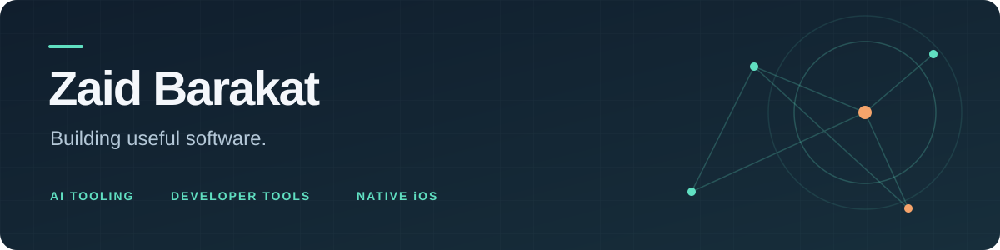

**Computer Science student @ Texas A&M University**

[LinkedIn](https://www.linkedin.com/in/zaidfbarakat) · [Projects](#selected-projects)

I love to turn ideas into working software, and then dig into the details that make it useful. My projects span repository Q&A, defensive AI security, interactive learning tools, and native iPhone apps. 

## Latest build · [Catalog Search](https://github.com/zaid-brk/catalog-search)

A C++ semantic product search engine with exact and IVF search, metadata filtering, and an automatic query planner. Includes a web demo and reproducible recall and latency benchmarks on real product catalogs.

**C++20 · Python · FastAPI · TypeScript**  
Personal project

## Selected projects

| Project | Engineering focus |
| :--- | :--- |
| **[Repo QA Agent](https://github.com/zaid-brk/repo-qa-agent)** | Ask questions about a GitHub repository and get answers with source citations. Combines retrieval with a multi-hop agent and a **50-question evaluation harness**. Python · FastAPI · LangChain · Qdrant · Next.js |
| **[Injection Redteam](https://github.com/zaid-brk/injection-redteam)** | A defensive prompt-injection testing framework with **42 attacks across 6 categories**, attack-success benchmarking, and layered defenses. Python · Defensive AI security |
| **[Catalog Search](https://github.com/zaid-brk/catalog-search)** | A C++ vector search engine with exact and IVF search, metadata filtering, and benchmarks for recall and latency. C++ · Python · FastAPI · TypeScript |

## Toolkit

| Area | Tools |
| :--- | :--- |
| Languages | C++20 · Python · TypeScript · JavaScript · Swift |
| Backend & data | FastAPI · SQLAlchemy · SQLite |
| AI & retrieval | LangChain · LangGraph · Qdrant |
| Web apps | Next.js · Streamlit |
| Native apps | SwiftUI · App Intents |

---

**Have an interesting problem or project?**  
[Let's connect on LinkedIn →](https://www.linkedin.com/in/zaidfbarakat)

